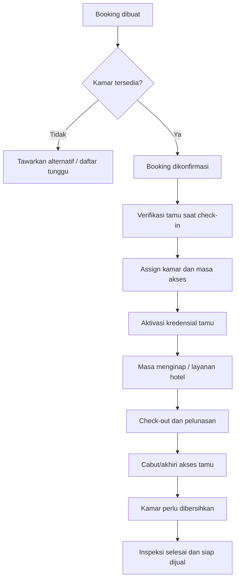
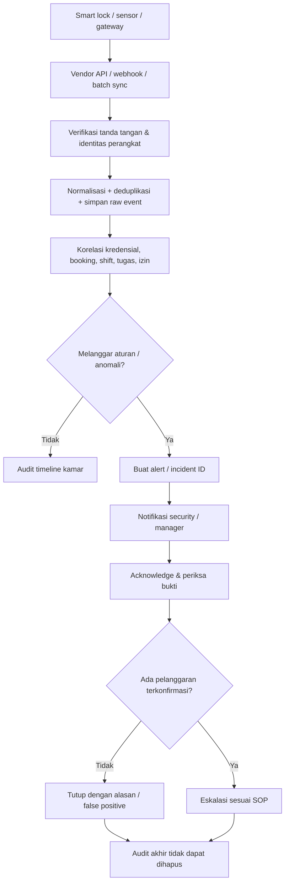
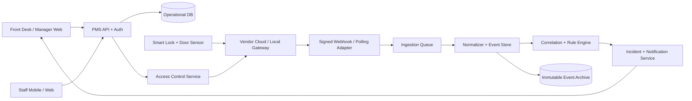

# PRD — Hotel Management System & Smart Door Access Monitoring

> **Nama produk (sementara):** HotelOps Guard  
> **Versi dokumen:** 1.0  
> **Tanggal:** 6 November 2026  
> **Status:** Draft untuk validasi bisnis dan teknis  
> **Bahasa:** Indonesia  
> **Platform:** Web responsif untuk operasional hotel; aplikasi mobile staf opsional pada fase berikutnya.

---

## 1. Ringkasan Eksekutif

HotelOps Guard adalah **Property Management System (PMS)** untuk hotel, penginapan, guest house, dan properti sejenis. Produk mencakup operasional hotel standar (reservasi, penjualan kamar, check-in/check-out, pembayaran, housekeeping, maintenance, tamu, laporan, dan administrasi), ditambah modul unggulan **Smart Door Access Monitoring & Audit Trail**.

Tujuan modul pintu adalah memudahkan hotel mengetahui **kapan akses ke kamar terjadi, kredensial apa yang digunakan, siapa pemegang akses yang terdaftar, dan apakah pintu secara fisik terbuka/tertutup**, apabila perangkat mendukung pembacaan posisi pintu. Sistem juga menghubungkan akses dengan reservasi, jadwal kerja, surat tugas, dan otorisasi, lalu mengirimkan peringatan jika terjadi anomali.

**Batasan penting:** Tidak ada sistem log kunci yang sendirian dapat memastikan **siapa orang yang benar-benar masuk** atau **berapa orang** yang masuk ke kamar. Satu kredensial dapat dipinjamkan atau dipakai untuk membuka pintu bagi orang lain. Pencegahan penyalahgunaan membutuhkan gabungan teknologi, kebijakan pengunjung, pengawasan area umum yang sah, dan prosedur audit.

### 1.1 Masalah bisnis

1. Reservasi, okupansi, pembayaran, dan laporan tersebar di spreadsheet/aplikasi berbeda.
2. Riwayat masuk ke kamar sulit ditelusuri ketika ada komplain atau kejadian keamanan.
3. Kartu master atau akses staf digunakan tanpa alasan operasional yang tercatat.
4. Kamar berstatus kosong/checkout berpotensi diakses tanpa penugasan.
5. Kunci elektronik, sensor, dan log resepsionis tidak terhubung dengan status reservasi.
6. Pimpinan kesulitan mengetahui kejadian mencurigakan secara tepat waktu.

### 1.2 Tujuan produk

- Memusatkan operasi hotel dalam satu aplikasi berbasis peran.
- Mencegah pemakaian akses staf yang tidak sesuai tugas dan jam kerja.
- Membuat audit log yang dapat diperiksa dan sulit dimanipulasi.
- Mengurangi keterlambatan respons atas pembukaan kamar yang mencurigakan.
- Mempertahankan keamanan fisik, keselamatan evakuasi, dan privasi tamu.

### 1.3 Non-goals

- **Bukan** sistem pengawasan audio/video di dalam kamar tamu.
- **Bukan** alat pengenal identitas otomatis setiap orang yang melewati pintu.
- **Bukan** jaminan tidak akan ada tamu/pegawai tanpa tercatat apabila ada akses fisik non-elektronik, kredensial dibagikan, atau jaringan/sensor bermasalah.
- **Bukan** pengganti sistem alarm kebakaran, prosedur evakuasi, atau perangkat keselamatan bersertifikasi.

## 2. Asumsi & Keputusan yang Perlu Dikonfirmasi

| Item | Asumsi awal | Keputusan saat implementasi |
|---|---|---|
| Tipe properti | Hotel kecil–menengah, dapat diperluas ke jaringan hotel | Jumlah properti dan kamar |
| Cabang | Single-property untuk MVP | Multi-property pada fase berikutnya |
| Zona waktu | `Asia/Jakarta` secara default, konfigurasi per properti | Zona waktu tiap hotel |
| Mata uang | IDR | Multi-currency bila dibutuhkan |
| Pajak & tagihan | Nilai/aturan dapat dikonfigurasi | Disesuaikan aturan pajak dan layanan setempat |
| Kunci kamar | Smart lock yang mendukung API/event export **atau** solusi dengan gateway | Vendor, model, firmware, lisensi, biaya SDK/API |
| Posisi fisik pintu | Sensor kontak magnetik/contact sensor atau fitur posisi pintu dari perangkat | Uji kompatibilitas per kamar |
| Moda internet | Koneksi dapat terputus | Perlu buffer lokal, status sinkronisasi, dan prosedur manual |
| CCTV | Opsional hanya di area publik/koridor yang sah | Kebijakan privasi dan retensi terpisah |
| Identitas tamu/pengunjung | Registrasi minimal sesuai keperluan operasional dan hukum | Kebijakan pengunjung dan dokumen identitas |

**Keputusan arsitektur:** Aplikasi harus dapat berjalan sebagai PMS tanpa smart lock. Fitur keamanan pintu aktif hanya pada kamar yang perangkatnya kompatibel dan telah tervalidasi.

## 3. Pengguna & Hak Akses

| Peran | Fungsi utama | Batasan keamanan |
|---|---|---|
| **Owner / Pemilik** | Dashboard global, laporan, setelan kebijakan, melihat insiden | Tidak menghapus/mengubah raw door audit log |
| **General Manager** | Persetujuan akses khusus, operasional, laporan, investigasi | Semua tindakan dan persetujuan diaudit |
| **Front Office / Resepsionis** | Reservasi, check-in/out, pembayaran, registrasi tamu/pengunjung, penerbitan kunci tamu | Tidak bisa menerbitkan akses master permanen |
| **Housekeeping** | Melihat tugas, status bersih, meminta/memakai akses kamar sesuai tugas | Hanya kamar/tanggal/jam yang diizinkan |
| **Engineering / Maintenance** | Tiket kerusakan, penugasan, inspeksi, akses berdasarkan tiket | Akses tamu aktif memerlukan prosedur/persetujuan |
| **Security** | Monitor pintu, menerima alarm, mencatat insiden, eskalasi | Tidak dapat memanipulasi event asal perangkat |
| **Finance / Accounting** | Folio, pembayaran, rekonsiliasi, laporan transaksi | Tidak mengelola master key kecuali izin terpisah |
| **Auditor** | Read-only laporan audit, insiden, perubahan data | Tidak mengubah data operasional |
| **IT / Device Admin** | Perangkat, gateway, webhook, integrasi, kesehatan sistem | Tidak otomatis berhak membuka kamar secara fisik |
| **Tamu (opsional)** | Lihat reservasi, check-in digital, akses mobile key jika didukung | Hanya akses reservasi/kamar sendiri |

Sistem menerapkan **RBAC** (role-based access control) dengan batasan tambahan berbasis properti, shift, kamar, tugas, status hunian, dan konteks (ABAC). Akun bersama tidak diperbolehkan untuk tindakan sensitif. MFA diwajibkan untuk peran berisiko tinggi. Persetujuan dan pemakaian akses tidak boleh selalu dilakukan oleh orang yang sama (segregation of duties).

## 4. Ruang Lingkup Fitur Standar PMS

Prioritas: **P0 = wajib MVP**, **P1 = penting sesudah MVP**, **P2 = pengembangan**.

| ID | Modul | Kebutuhan | Prioritas |
|---|---|---|---|
| PMS-001 | Properti & kamar | Data properti, gedung, lantai, nomor kamar, jenis tempat tidur, fasilitas, kapasitas, harga dasar | P0 |
| PMS-002 | Status kamar | Available, Reserved, Occupied, Dirty, Cleaning, Inspected, Out-of-Order, Out-of-Service; status hunian dan kebersihan dipisah | P0 |
| PMS-003 | Rate & inventory | Harga weekday/weekend, musim, promo, allotment, stop-sell, batas kapasitas | P0 |
| PMS-004 | Kalender reservasi | Tampilan harian/mingguan/bulanan, pencarian kamar, ketersediaan realtime, pencegahan double booking | P0 |
| PMS-005 | Booking | Walk-in, telepon, website, corporate, OTA manual; hold, confirm, cancel, no-show | P0 |
| PMS-006 | Data tamu | Profil tamu, kontak, preferensi operasional, histori menginap, dokumen dengan akses terbatas | P0 |
| PMS-007 | Check-in | Verifikasi tamu, deposit, assign kamar, pencatatan pendamping terdaftar, aktivasi kunci | P0 |
| PMS-008 | Check-out | Periksa tagihan, selesaikan pembayaran/deposit, nonaktifkan kredensial, ubah status kamar | P0 |
| PMS-009 | Folio & pembayaran | Room charge, biaya tambahan, pajak/layanan configurable, diskon, refund, split folio, metode pembayaran, invoice | P0 |
| PMS-010 | Housekeeping | Board tugas, prioritas pembersihan, hasil inspeksi, lost-and-found, waktu mulai/selesai | P0 |
| PMS-011 | Maintenance | Tiket kerusakan, SLA, teknisi, lampiran, persetujuan masuk kamar dan kondisi out-of-order | P0 |
| PMS-012 | Shift operasional | Jadwal/shift staf, handover, catatan pergantian shift | P0 |
| PMS-013 | Laporan | Occupancy, ADR, RevPAR, revenue, pembayaran, piutang, aktivitas staf, audit akses | P0 |
| PMS-014 | Pengguna & izin | Undangan akun, peran, MFA, session management, pencabutan akses | P0 |
| PMS-015 | Audit aktivitas aplikasi | Perubahan harga, booking, pembayaran, penugasan, penerbitan kunci, pengaturan sistem | P0 |
| PMS-016 | Notifikasi | In-app, email opsional, antrean notifikasi, acknowledgement | P0 |
| PMS-017 | Registrasi pengunjung | Pendaftaran pengunjung/pendamping, kamar tujuan, host, rentang waktu, catatan persetujuan | P0 |
| PMS-018 | Tarif/promosi lanjutan | Paket menginap, corporate rate, seasonal pricing, voucher | P1 |
| PMS-019 | Channel manager | Sinkronisasi OTA/website booking engine berdasarkan kontrak API | P1 |
| PMS-020 | POS | Restoran, minibar, laundry, room service, posting ke folio | P1 |
| PMS-021 | Inventory | Linen, amenities, stok barang, pembelian, keluar-masuk barang | P1 |
| PMS-022 | Mobile staff | Aplikasi tugas housekeeping/security/engineering | P1 |
| PMS-023 | Guest portal | Portal reservasi, digital check-in, pesan layanan, e-receipt | P1 |
| PMS-024 | Multi-property | Dashboard antar-cabang, konsolidasi keuangan, kebijakan lokal per properti | P2 |
| PMS-025 | Analitik lanjutan | Forecast okupansi, prediksi demand, laporan pola insiden | P2 |

### 4.1 Alur standar reservasi hingga check-out



**Aturan:** ketersediaan kamar dan harga harus dihitung transaksional pada backend; jangan percaya hanya pada tampilan kalender pengguna. Semua pembatalan/override menghasilkan audit trail.

---

## 5. Modul Unggulan: Smart Door Access Monitoring

### 5.1 Tujuan dan prinsip teknis

Setiap kamar dapat memiliki perangkat smart lock, ID perangkat, konfigurasi konektivitas, dan (direkomendasikan) sensor posisi fisik daun pintu. Sistem mengumpulkan event dari perangkat melalui **webhook/API vendor**, **gateway lokal**, atau **sinkronisasi batch** apabila lock offline.

Penting membedakan peristiwa berikut:

1. **Access attempted**: kredensial dicoba; belum tentu berhasil.
2. **Access granted / unlock**: kunci menerima kredensial atau mekanisme dibuka; **belum berarti daun pintu bergerak**.
3. **Door opened**: sensor posisi mendeteksi daun pintu terbuka.
4. **Door closed**: sensor posisi mendeteksi daun pintu tertutup; **belum tentu deadbolt terkunci**.
5. **Door locked**: mekanisme terkunci (jika status tersedia).
6. **Forced/unauthorized opening**: sensor mendeteksi pembukaan tanpa valid unlock terkait (perlu aturan korelasi dan pengecualian).

**Persyaratan pengadaan hardware:** jika hotel menuntut pencatatan setiap buka/tutup fisik, **wajib menguji sensor posisi pintu, API untuk event open/close, ketahanan baterai, gateway, timestamp, serta pengiriman event saat offline**. Banyak hotel lock hanya menyimpan audit pemakaian kartu dan tidak mengirim event close secara real-time.

### 5.2 Skema kemampuan hardware

| Kemampuan | Kartu RFID hotel offline | Smart lock online tanpa sensor posisi | Smart lock online + sensor posisi |
|---|---|---|---|
| Identitas kredensial yang digunakan | Umumnya tersedia di log perangkat, tergantung vendor | Tersedia jika API mendukung | Tersedia jika API mendukung |
| Unlock / akses berhasil | Biasanya tersimpan lokal; sinkronisasi tertunda | Biasanya dapat dilaporkan | Biasanya dapat dilaporkan |
| **Daun pintu benar-benar terbuka** | Tidak dapat dipastikan tanpa sensor | Tidak dapat dipastikan tanpa sensor | **Dapat dideteksi** |
| **Daun pintu benar-benar tertutup** | Tidak dapat dipastikan tanpa sensor | Tidak dapat dipastikan tanpa sensor | **Dapat dideteksi** |
| Alarm pintu dibiarkan terbuka | Perlu perangkat tambahan | Perlu sensor/fitur khusus | Bisa dengan aturan dan sensor |
| Alert langsung | Umumnya tidak | Bisa jika koneksi mendukung | Bisa jika koneksi mendukung |
| Identitas semua orang yang masuk | **Tidak** | **Tidak** | **Tidak** |

Ketersediaan fitur bergantung pada **model, konfigurasi, lisensi, firmware, gateway, dan kontrak integrasi vendor**. Jangan mengunci desain pada satu merek sebelum proof-of-concept.

### 5.3 Jenis event minimum

| Kode event standar | Makna | Sumber / kondisi |
|---|---|---|
| `ACCESS_GRANTED` | Kredensial valid | Lock/access controller |
| `ACCESS_DENIED` | Kredensial ditolak | Lock/access controller |
| `LOCK_UNLOCKED` | Mekanisme kunci terbuka | Lock |
| `LOCK_LOCKED` | Mekanisme kunci terkunci | Lock |
| `DOOR_OPENED` | Daun pintu terbuka | Door contact sensor |
| `DOOR_CLOSED` | Daun pintu tertutup | Door contact sensor |
| `DOOR_HELD_OPEN` | Terbuka lebih lama dari ambang | Rule engine berbasis sensor |
| `DOOR_FORCED_OPEN` | Terbuka tanpa unlock terkait | Rule engine dan/atau lock; tidak selalu berarti pembobolan |
| `MASTER_KEY_USED` | Kredensial dengan akses master digunakan | Hasil klasifikasi credential di PMS |
| `REMOTE_UNLOCK_REQUESTED` | Perintah remote unlock diajukan | PMS / admin |
| `REMOTE_UNLOCK_RESULT` | Vendor mengonfirmasi/gagal | Vendor / gateway |
| `EMERGENCY_OVERRIDE` | Akses darurat digunakan | Prosedur darurat / lock |
| `CREDENTIAL_ISSUED` | Kunci/kartu/PIN diterbitkan | PMS / perangkat akses |
| `CREDENTIAL_REVOKED` | Akses dicabut | PMS / perangkat akses |
| `DEVICE_OFFLINE` | Gateway/lock tidak melapor | Monitoring konektivitas |
| `DEVICE_ONLINE` | Konektivitas pulih | Monitoring konektivitas |
| `SENSOR_TAMPER` | Sensor diduga diutak-atik | Perangkat jika mendukung |
| `LOW_BATTERY` | Baterai lemah | Perangkat jika mendukung |
| `EVENT_SYNCED` | Catatan offline disinkronkan | Ingestion service |

**Jangan membuat event `DOOR_CLOSED` berdasarkan `LOCK_LOCKED` atau sebaliknya.** Semua event harus mempertahankan tipe asli dan tingkat kepercayaan sumbernya.

### 5.4 Persyaratan fungsional modul pintu

| ID | Kebutuhan / acceptance ringkas | Prioritas |
|---|---|---|
| ACC-001 | Admin dapat memetakan `hotel -> lantai -> kamar -> lock_id -> sensor_id -> gateway_id` | P0 |
| ACC-002 | Terima event vendor via webhook terautentikasi / adapter gateway | P0 |
| ACC-003 | Simpan `occurred_at` (waktu kejadian di perangkat) **dan** `received_at` (waktu diterima server), UTC; UI dalam zona hotel | P0 |
| ACC-004 | Event duplikat tidak membuat catatan ganda; raw payload disimpan terenkripsi/referensinya sesuai kebijakan | P0 |
| ACC-005 | Event diterjemahkan ke tipe normalisasi dengan nama vendor tetap tersimpan | P0 |
| ACC-006 | Hubungkan credential dengan pemegang, peran, status aktif, dan masa berlaku pada saat kejadian | P0 |
| ACC-007 | Hubungkan event dengan reservasi **yang berlaku pada waktu kejadian**, bukan hanya status kamar saat dilihat | P0 |
| ACC-008 | Hubungkan akses staf dengan shift, penugasan housekeeping/maintenance, izin dan reason code | P0 |
| ACC-009 | Dashboard live event, daftar kamar, open/closed/unknown/offline, dan insiden | P0 |
| ACC-010 | Pencarian filter: kamar, orang/kredensial, periode, jenis event, status, severity, perangkat | P0 |
| ACC-011 | Alert untuk akses master, kamar kosong, di luar shift, akses ditolak berulang, forced open, held open, sensor offline | P0 |
| ACC-012 | Workflow acknowledgement, investigasi, catatan bukti, keputusan, eskalasi, close incident | P0 |
| ACC-013 | Log event bersifat append-only, tidak tersedia fungsi edit/delete manual; koreksi dengan event tambahan | P0 |
| ACC-014 | Sistem dapat membedakan `live`, `delayed`, `offline`, dan `unknown`; jangan mengklaim real-time bila tidak ada koneksi | P0 |
| ACC-015 | Penerbitan master/temporary staff key wajib permintaan, alasan, ruang lingkup, waktu berakhir, dan persetujuan sesuai kebijakan | P0 |
| ACC-016 | Semua remote unlock wajib role khusus, alasan, MFA, konfirmasi, log, dan persetujuan pada kasus berisiko | P1 |
| ACC-017 | Jika ada integrasi CCTV koridor, lampirkan **referensi** potongan waktu kejadian untuk investigasi yang sah (tanpa kamera dalam kamar) | P1 |
| ACC-018 | Sinkronisasi dua arah credential/perizinan dengan vendor yang mendukung; penanganan kegagalan revoke | P1 |
| ACC-019 | Ekspor audit CSV/PDF terbatas role dengan watermark, alasan unduh dan jejak ekspor | P1 |
| ACC-020 | Analitik pola kejadian per shift/per kamar tanpa profiling otomatis yang menghasilkan hukuman | P2 |

### 5.5 Contoh rekaman audit

**Contoh ilustratif**, bukan data nyata:

| Waktu lokal | Kamar | Kejadian | Identitas terkait | Konteks | Penilaian |
|---|---|---|---|---|---|
| 21:03:12 | 305 | `ACCESS_GRANTED` | RFID staf HK-024 | Tidak ada tugas aktif | Perlu pemeriksaan |
| 21:03:15 | 305 | `DOOR_OPENED` | Sensor D-305 | Terkait unlock staf dalam 3 detik | Insiden prioritas tinggi |
| 21:07:40 | 305 | `DOOR_CLOSED` | Sensor D-305 | Pintu terbuka 4 menit 25 detik | Ditambahkan ke insiden |
| 21:07:45 | 305 | `LOCK_LOCKED` | Smart lock L-305 | Kunci berhasil terkunci | Dicatat |

Kesimpulan yang **boleh** ditampilkan: “Kredensial staf HK-024 digunakan untuk membuka kunci kamar 305; sensor mendeteksi pintu dibuka dan ditutup; tidak ditemukan tugas aktif pada waktu kejadian.”  
Kesimpulan yang **tidak boleh otomatis ditampilkan**: “Staf HK-024 memasukkan seorang tamu ilegal.” Hal itu membutuhkan investigasi dan bukti tambahan.

### 5.6 Alur pemantauan dan investigasi



### 5.7 Aturan deteksi anomali (konfigurabel)

Aturan berlaku terhadap event **yang benar-benar tersedia**. Toleransi korelasi dan ambang berikut adalah nilai awal untuk diuji di lokasi, bukan jaminan universal.

| Rule ID | Kondisi | Severity default | Tindakan |
|---|---|---|---|
| RULE-01 | `DOOR_OPENED` saat kamar **Vacant** dan tidak ada tugas, izin, atau keadaan darurat | High | Alert security + manager |
| RULE-02 | `MASTER_KEY_USED` di luar shift atau scope ruang yang ditetapkan | High | Alert + wajib reason code |
| RULE-03 | Akses staf ke kamar **Occupied** tanpa tugas/izin/permintaan tamu | High | Alert + pemeriksaan manual cepat |
| RULE-04 | `DOOR_OPENED` tanpa `LOCK_UNLOCKED`/akses sah di rentang korelasi, dan tidak berasal dari pintu yang dibuka dari dalam | Critical | Alarm investigasi; evaluasi sensor / model kunci |
| RULE-05 | `DOOR_HELD_OPEN` selama > 180 detik pada kamar vacant atau area terbatas | Medium | Notifikasi security |
| RULE-06 | >= 5 `ACCESS_DENIED` pada kamar yang sama dalam 10 menit | Medium | Notifikasi security |
| RULE-07 | Penggunaan credential setelah checkout/masa berlaku berakhir | High | Notifikasi + periksa kegagalan revoke |
| RULE-08 | Penggunaan staf pada kamar yang berbeda secara beruntun di luar tugas yang ditetapkan | Medium | Review pola, bukan tuduhan otomatis |
| RULE-09 | Perangkat offline melebihi 10 menit atau event tidak sinkron | Medium | Alert kualitas pemantauan; status **monitoring gap** |
| RULE-10 | Penerbitan kartu duplikat/master tanpa tiket atau persetujuan | Critical | Tahan tindakan jika memungkinkan; eskalasi |
| RULE-11 | Remote unlock tanpa alasan tercatat atau tanpa approval wajib | Critical | Tolak perintah dan catat percobaan |
| RULE-12 | `DOOR_OPENED` ketika kamar Out-of-Order tanpa izin maintenance | High | Alert security/engineering |

**Pengecualian wajib:** pembukaan dari dalam kamar, tamu yang berhak, pekerjaan terjadwal, akses penyelamatan, evakuasi, dan uji perangkat. Jika tidak ada sinyal arah buka, sistem memberi klasifikasi **“perlu verifikasi”**, bukan tuduhan forced entry. **Tidak boleh memblokir jalur keluar darurat** karena aturan software.

### 5.8 Siklus insiden

Status: `NEW -> ACKNOWLEDGED -> INVESTIGATING -> RESOLVED / FALSE_POSITIVE -> CLOSED`; `REOPENED` bila ada bukti baru.

Setiap insiden menyimpan `incident_id`, rule yang terpicu, daftar event terkait, kamar, waktu, level risiko, petugas penanggung jawab, kronologi, bukti yang diizinkan, alasan keputusan, dan waktu perubahan status. Peningkatan ke pelanggaran disiplin selalu melalui evaluasi manusia dan SOP SDM; alert bukan bukti kesalahan otomatis.

### 5.9 Pencegahan staf memasukkan orang tanpa tercatat

Selain perangkat pintu, produk wajib mendukung kontrol operasional berikut:

1. **Registrasi tamu dan pengunjung:** siapa yang akan mengunjungi kamar, kontak seperlunya, host/kamar tujuan, waktu mulai–akhir, persetujuan bila disyaratkan.
2. **Kredensial personal:** setiap karyawan memiliki credential sendiri; kartu master bersama dilarang atau dikendalikan sebagai pengecualian terinventarisir.
3. **Akses berdasarkan tugas:** housekeeper hanya mendapat kamar yang ditugaskan, pada rentang kerja yang sah; engineering berdasarkan work order.
4. **Persetujuan akses khusus:** kamar dihuni, vacant tanpa tugas, remote unlock, dan master access diproses menurut tingkat risiko; prosedur darurat mengizinkan *break glass* dengan audit dan review sesudahnya.
5. **Kartu cadangan:** penerbitan/duplikasi/reset/revoke dicatat dengan siapa penerbit dan penerima; masa berlaku minimum sesuai kebutuhan.
6. **Kebijakan pengunjung:** kebijakan hotel disampaikan kepada tamu dan staf; ketidakpatuhan ditangani dengan pemeriksaan, tidak semata-mata inferensi dari log pintu.
7. **Pengawasan area umum yang proporsional:** rekaman CCTV lorong/lobi bila memang diperlukan, memiliki dasar hukum, pemberitahuan, pembatasan akses dan retensi; **tidak ada kamera di kamar atau kamar mandi**.
8. **Kunci fisik darurat:** bila ada, wajib sistem serah-terima kunci, segel atau lemari kunci terkontrol, saksi dan laporan penggunaan; sensor pintu tetap bisa mencatat pembukaan tetapi mungkin tidak mengidentifikasi pelaku.

**Batas bukti:** kombinasi log kredensial + sensor pintu + booking/tugas dapat menunjukkan anomali akses, bukan menghitung orang yang masuk atau memastikan identitas mereka. Pengunjung yang ikut masuk bersama pemegang kunci tetap mungkin tidak terdeteksi satu-per-satu.

---

## 6. Detail Alur Operasional

### 6.1 Staf housekeeping masuk ke kamar

1. Supervisor membuat dan mengalokasikan tugas ke petugas tertentu.
2. PMS memverifikasi kamar, shift, status hunian, dan rentang waktu tugas.
3. Credential petugas diberi hak terbatas melalui vendor (jika didukung); bila tidak, kontrol dilakukan pada level prosedur dan audit.
4. Lock mengirim `ACCESS_GRANTED` / `LOCK_UNLOCKED`; sensor mengirim `DOOR_OPENED` dan `DOOR_CLOSED`.
5. Event berkorelasi dengan penugasan, petugas, dan waktu; status normal jika memenuhi aturan.
6. Staf mengisi checklist housekeeping dan menyelesaikan tugas; semua langkah dapat diaudit.
7. Jika di luar tugas, sistem membuat insiden. Tim security/manajer menilai konteks sebelum mengambil tindakan.

### 6.2 Teknisi perlu masuk kamar yang sedang dihuni

1. Front office / tamu membuat tiket perbaikan.
2. Penanggung jawab menetapkan teknisi, jadwal, alasan, dan metode masuk sesuai SOP persetujuan/kehadiran tamu.
3. Jika perlu, supervisor menyetujui akses untuk slot dan kamar tertentu.
4. Sistem mencatat penerbitan/aktivasi credential temporer dan seluruh event akses.
5. Teknisi menutup work order dengan hasil pekerjaan dan dokumentasi seperlunya.
6. Akses temporer otomatis berakhir atau dicabut, dengan bukti hasil pencabutan dari vendor.

### 6.3 Akses kamar tanpa reservasi

1. Kamar berstatus `Vacant` dan tidak memiliki housekeeping task/maintenance ticket aktif.
2. Smart lock melaporkan kredensial staf digunakan; sensor melaporkan `DOOR_OPENED`.
3. Engine mendeteksi tidak ada konteks akses yang sah pada waktu event.
4. Sistem membuat insiden berisiko tinggi, mengirim notifikasi ke security/manajer, dan menyimpan audit timeline.
5. Petugas keamanan melakukan pemeriksaan SOP, bila sesuai hukum/kebijakan dapat memeriksa rekaman koridor terkait.
6. Penyelesaian membutuhkan catatan hasil investigasi. Raw log tidak diubah.

### 6.4 Koneksi internet/gateway putus

1. Monitoring mendeteksi perangkat berhenti berkomunikasi dan menampilkan `OFFLINE` / `MONITORING GAP`.
2. Operasi kunci lokal harus tetap mengikuti mode keselamatan dan hak akses offline yang didukung hardware; jangan mengandalkan server untuk **egress darurat**.
3. Jika lock menyimpan event lokal, event masuk saat sinkronisasi dengan `occurred_at` asli, waktu diterima baru dan status `DELAYED`.
4. Jika lock tidak menyimpan event saat offline, sistem secara eksplisit menandai periode **tidak tercatat**, tanpa merekayasa data.
5. Setelah pulih, jalankan pemeriksaan kelengkapan event, baterai, jam perangkat, dan rekonsiliasi.

### 6.5 Kunci hilang/pegawai berhenti bekerja

1. Security/front office mencatat laporan kunci hilang atau HR menonaktifkan karyawan.
2. PMS mengirim perintah revoke ke lock provider untuk seluruh kamar/credential terkait.
3. Status tidak boleh ditampilkan **“sudah tercabut”** sampai ada konfirmasi yang memadai dari provider/perangkat; jika offline, tampilkan `REVOKE_PENDING` dan risiko.
4. Terapkan prosedur fisik mitigasi sesuai vendor, termasuk pembaruan lock offline bila diperlukan.
5. Seluruh waktu permintaan, konfirmasi, kegagalan, dan operator dicatat.

---

## 7. Struktur Halaman dan UI

### 7.1 Navigasi utama

- **Dashboard:** okupansi, revenue ringkas, arrivals/departures, kamar butuh dibersihkan, perangkat offline, alert aktif.
- **Front Desk:** reservation calendar, pencarian, walk-in, check-in/check-out, tamu, pengunjung, kartu tamu.
- **Rooms:** daftar kamar, status hunian & kebersihan terpisah, status akses, sensor, jadwal.
- **Housekeeping:** board tugas, mulai/selesai, inspeksi, catatan.
- **Maintenance:** work order, inventaris perangkat, kerusakan, SLA.
- **Door Monitoring:** live timeline, peta lantai, room detail, perangkat bermasalah.
- **Incidents:** antrean alert, prioritas, assignment, kronologi, penyelesaian.
- **Finance:** folio, pembayaran, refund, invoice, rekonsiliasi.
- **Reports:** KPI hotel, pendapatan, audit akses dan aktivitas sistem.
- **Settings:** properti, role, shift, threshold, vendor integration, retensi, keamanan, billing.

### 7.2 Tampilan Monitoring Pintu

Filter utama: Hotel / lantai / nomor kamar / shift / tanggal / jenis event / severity / staf / status sensor.

Setiap kartu kamar menampilkan:

- **Nomor kamar** dan status `Vacant / Occupied / Out-of-Order`.
- **Status posisi pintu** `OPEN / CLOSED / UNKNOWN` (hanya jika ada sensor).
- **Status mekanisme kunci** `LOCKED / UNLOCKED / UNKNOWN` (jika vendor mendukung).
- Kesehatan perangkat: `ONLINE / OFFLINE`, baterai, `last_seen_at`.
- Waktu event terakhir, event tertunda, dan insiden aktif.
- Ringkas konteks: reservasi aktif, tugas sah, penanggung jawab.

> Jangan menyamakan `ROOM VACANT`, `DOOR CLOSED`, dan `LOCK LOCKED`: ketiganya adalah dimensi status berbeda.

### 7.3 Halaman Detail Kamar

Tab: **Overview**, **Reservations**, **Door Events**, **Key/Credential History**, **Housekeeping**, **Maintenance**, **Incidents**, **Change History**. Tampilkan sumber event dan apakah data diperoleh live atau tertunda. Data pribadi disamarkan jika tidak dibutuhkan peran pengguna.

---

## 8. Model Data Awal

### 8.1 Entitas inti

| Entitas | Kolom inti (contoh) |
|---|---|
| `properties` | `id, name, timezone, address, settings_json` |
| `rooms` | `id, property_id, building_id, floor, number, room_type_id, occupancy_status, housekeeping_status, service_status` |
| `room_types` | `id, property_id, name, capacity, base_rate` |
| `guests` | `id, property_id, name, contact_encrypted, identity_document_ref, created_at` |
| `reservations` | `id, property_id, room_id, guest_id, checkin_at, checkout_at, status, source, rate_plan_id` |
| `registered_visitors` | `id, property_id, room_id, host_reservation_id, visitor_ref, visit_start, visit_end, approval_id, status` |
| `folios` | `id, reservation_id, currency, total, balance, status` |
| `folio_items` | `id, folio_id, charge_type, amount, tax, posted_by, posted_at` |
| `payments` | `id, folio_id, method, amount, reference, status, processed_at` |
| `staff_users` | `id, property_id, employee_code, role, account_status` |
| `staff_shifts` | `id, staff_id, starts_at, ends_at, department` |
| `work_orders` | `id, property_id, room_id, staff_id, type, reason, starts_at, ends_at, status, approval_id` |
| `access_devices` | `id, property_id, room_id, vendor, model, vendor_device_id, gateway_id, capabilities_json, last_seen_at` |
| `door_sensors` | `id, room_id, device_id, vendor_sensor_id, health_status` |
| `access_credentials` | `id, provider_credential_ref, holder_type, holder_id, credential_kind, scope, valid_from, valid_until, status` |
| `access_authorizations` | `id, room_id, staff_id, work_order_id, requested_by, approved_by, reason, starts_at, ends_at, status` |
| `door_events` | `id, event_key, source, device_id, room_id, normalized_type, vendor_type, occurred_at, received_at, credential_id_nullable, door_state_nullable, lock_state_nullable, raw_ref, sync_status` |
| `event_correlations` | `id, door_event_id, reservation_id_nullable, shift_id_nullable, work_order_id_nullable, authorization_id_nullable, confidence, rule_version` |
| `incidents` | `id, property_id, room_id, severity, status, opened_at, assigned_to, closed_at, closure_reason` |
| `incident_events` | `incident_id, door_event_id` |
| `audit_logs` | `id, actor_id, action, entity_type, entity_id, before_hash, after_hash, timestamp, ip, request_id` |
| `notification_deliveries` | `id, incident_id, channel, recipient_id, delivery_status, sent_at, acknowledged_at` |

### 8.2 Field wajib di setiap door event

- `event_id` internal unik (UUID).
- `source_event_id` dari vendor jika tersedia.
- `property_id`, `room_id`, `device_id`, `gateway_id` bila ada.
- `event_type` ternormalisasi dan `vendor_event_type` asli.
- `occurred_at_utc`, `received_at_utc`, `device_time_quality` (`trusted/estimated/unknown`).
- `credential_id` atau `credential_hash` bila diberikan vendor; jangan simpan PIN/kunci rahasia dalam plaintext.
- `actor_type`, `actor_id` (boleh null jika identitas tak tersedia), `actor_resolution_status`.
- `door_state`, `lock_state` nullable dan jangan diinferensikan tanpa data.
- `source`, `sync_status` (`LIVE`, `DELAYED`, `BATCH`, `UNKNOWN`).
- `signature_verified`, `raw_payload_ref`, `raw_payload_hash`, `ingestion_version`.

### 8.3 Contoh JSON event normalisasi

```json
{
  "event_id": "9e235abe-8e45-44ea-9a55-a2b0fedb9637",
  "source_event_id": "vendor-event-87422",
  "property_id": "hotel-001",
  "room_id": "room-305",
  "device_id": "door-sensor-305",
  "event_type": "DOOR_OPENED",
  "vendor_event_type": "contact.open",
  "occurred_at_utc": "2026-11-06T14:03:15Z",
  "received_at_utc": "2026-11-06T14:03:16Z",
  "door_state": "OPEN",
  "lock_state": null,
  "credential_id": null,
  "actor_id": null,
  "actor_resolution_status": "NOT_AVAILABLE_FROM_SENSOR",
  "sync_status": "LIVE",
  "device_time_quality": "trusted",
  "signature_verified": true,
  "raw_payload_ref": "encrypted-object-ref",
  "raw_payload_hash": "sha256:example-redacted"
}
```

**Korelasi identitas:** event sensor pintu umumnya tidak memiliki nama pelaku. Backend dapat mengaitkannya dengan unlock terbaru yang relevan dalam interval waktu yang dikonfigurasi, tetapi harus menyimpan `confidence` dan mengizinkan `UNATTRIBUTED`.

### 8.4 Integritas dan retensi log

- Raw door event bersifat **append-only**; perubahan status investigasi tidak mengubah event sumber.
- Event ingestion menggunakan unique constraint, misalnya `(vendor, source_event_id)`; untuk vendor tanpa ID unik perlu kunci deduplikasi berbasis kombinasi perangkat/jenis/waktu/payload dengan toleransi teruji.
- Simpan audit metadata secara immutable/tamper-evident (hash chain atau WORM/object lock sesuai kebutuhan) dengan backup terenkripsi.
- Tetapkan retensi per kategori dan kebutuhan hukum. **Usulan awal untuk diskusi, bukan ketentuan hukum:** door access logs 180 hari, extended incident evidence berdasarkan legal hold, application audit logs 1 tahun; finalisasi melalui penilaian privasi dan penasihat hukum. Jangan menyimpan tanpa batas hanya karena secara teknis memungkinkan.
- Hak akses ekspor, lihat, hapus menurut jadwal retensi, dan legal hold harus dapat diaudit. Penghapusan sesuai kebijakan retensi tidak dilakukan melalui fitur edit biasa.

---

## 9. API & Integrasi

### 9.1 Arsitektur ringkas



### 9.2 Usulan endpoint internal

| Method | Endpoint | Kegunaan / kontrol |
|---|---|---|
| `GET` | `/api/v1/rooms` | Daftar kamar dan filter status, RBAC properti |
| `POST` | `/api/v1/reservations` | Buat reservasi, idempotency key untuk retry |
| `POST` | `/api/v1/reservations/{id}/check-in` | Check-in, validasi identitas/folio/room |
| `POST` | `/api/v1/reservations/{id}/check-out` | Checkout dan workflow revoke |
| `GET` | `/api/v1/rooms/{id}/door-events` | Audit timeline dengan filter dan pagination |
| `POST` | `/api/v1/rooms/{id}/access-requests` | Minta otorisasi temporer dengan reason code |
| `POST` | `/api/v1/access-requests/{id}/approve` | Approval oleh role berbeda bila diwajibkan |
| `POST` | `/api/v1/credentials` | Terbitkan credential sesuai wewenang |
| `POST` | `/api/v1/credentials/{id}/revoke` | Revoke asinkron dan tracking konfirmasi |
| `POST` | `/api/v1/rooms/{id}/remote-unlock` | Opsional, MFA dan approval ketat, default nonaktif |
| `POST` | `/api/v1/integrations/{vendor}/webhook` | Verifikasi HMAC/signature/token, replay protection |
| `GET` | `/api/v1/incidents` | Filter insiden berdasarkan role |
| `POST` | `/api/v1/incidents/{id}/acknowledge` | Ack dengan jejak actor/waktu |
| `POST` | `/api/v1/incidents/{id}/resolve` | Kesimpulan dan bukti, tidak mengubah raw event |
| `GET` | `/api/v1/devices/health` | Last seen, battery, sync delay, sensor status |
| `GET` | `/api/v1/reports/access-audit` | Ekspor terotorisasi dan diaudit |

API harus memiliki auth, validasi skema, pagination, rate limiting, scope tenant, audit tindakan penting, dan mekanisme idempotency. Webhook vendor **tidak** menggunakan user session biasa.

### 9.3 Integrasi vendor (adapter pattern)

Buat interface `LockProviderAdapter` dengan fungsi opsional sesuai kemampuan vendor:

```ts
interface LockProviderAdapter {
  getCapabilities(deviceId: string): Promise<LockCapabilities>;
  verifyAndParseWebhook(payload: unknown, headers: Record<string, string>): Promise<VendorEvent[]>;
  getDeviceHealth(deviceId: string): Promise<DeviceHealth>;
  issueCredential?(request: CredentialRequest): Promise<ProviderOperation>;
  revokeCredential?(credentialId: string): Promise<ProviderOperation>;
  requestRemoteUnlock?(deviceId: string, request: AuthorizedUnlock): Promise<ProviderOperation>;
  fetchHistoricalEvents?(deviceId: string, cursor?: string): Promise<VendorEventPage>;
}
```

Fitur `?` berarti vendor mungkin **tidak menyediakan** endpoint terkait. Core PMS tidak boleh mengasumsikan semua provider sama.

### 9.4 Reliabilitas event

- Gunakan queue untuk memproses webhook dan merespons cepat setelah event diterima aman.
- Konfirmasi authenticity (signature/allowlisted credentials), verifikasi tenant dan device mapping.
- Terapkan retry + dead-letter queue untuk event gagal, dan alert bila backlog menumpuk.
- Event bisa datang **tidak berurutan**; korelasi menggunakan `occurred_at`, dengan mempertimbangkan clock drift.
- Tunjukkan indikator keterlambatan dan kualitas data; alert real-time hanya jika latensi perangkat memadai.
- Jangan menyimpulkan “tidak ada akses” pada periode offline tanpa audit lokal tersinkron.
- Sediakan replay terkontrol untuk event yang gagal dengan idempotency, audit, dan pembatasan akses.

---

## 10. Persyaratan Non-Fungsional

| Area | Target awal / prinsip | Verifikasi |
|---|---|---|
| Keamanan akun | MFA untuk admin/manager/security, password hashing standar modern, session expiry, RBAC/ABAC | Security test |
| Proteksi data | TLS in transit, enkripsi at rest, secret management, least privilege, masking dokumen identitas | Audit konfigurasi |
| Integritas audit | Append-only, pengujian tamper evidence, backup dan restore | Uji perubahan ilegal |
| Ketersediaan PMS | Target awal 99,5% uptime bulanan untuk sistem aplikasi (di luar dependensi vendor, perlu SLA) | Monitoring |
| Respons UI | p95 API untuk halaman operasional umum < 2 detik dalam beban target | Load test |
| Alert latency | Untuk **perangkat online sehat**: target internal p95 < 30 detik sejak event diterima backend hingga notifikasi diterbitkan; **bukan** SLA sejak pintu fisik dibuka | End-to-end test |
| Sinkronisasi | Event offline diberi flag delayed dan tidak hilang selama provider menyimpannya; gap dilaporkan | Disconnect/reconnect test |
| Skala awal | 1 properti, 100 kamar, 50 akun staff, 100.000 door events/bulan (asumsi capacity planning) | Load test |
| Backup | Target awal RPO <= 15 menit dan RTO <= 4 jam untuk database operasional, sesuai kapasitas infra | Restore drill |
| Auditabilitas | Semua view/ekspor data sensitif dan operasi berisiko tercatat | Audit sampling |
| Accessibility | Keyboard navigation, label form, warna status + teks, responsif mobile | UX QA |
| Waktu | UTC di penyimpanan, timezone per properti, sinkronisasi waktu gateway/perangkat | Time drift tests |
| Safety | Unlock/lock policy tidak mengganggu mekanisme keluar darurat atau kewajiban keselamatan bangunan | Review vendor/ahli keselamatan |

Angka non-fungsional ini **target rancangan awal**, perlu validasi setelah pilot dan penawaran vendor.

## 11. Keamanan, Privasi, dan Tata Kelola

1. **UU No. 27 Tahun 2022 tentang Pelindungan Data Pribadi (UU PDP):** petakan dasar pemrosesan, tujuan, minimisasi data, pemberitahuan privasi, pembatasan akses, keamanan, masa retensi, dan mekanisme hak subjek data.
2. Gunakan data yang perlu untuk akuntabilitas; rekaman aktivitas pegawai dan tamu tergolong data terkait individu dan harus memiliki tujuan yang sah serta transparan.
3. Lakukan penilaian dampak pelindungan data jika pemrosesan berisiko tinggi, khususnya pemantauan sistematis atau integrasi CCTV/biometrik. Ini memerlukan penilaian hukum sesuai implementasi.
4. Jangan mengimplementasikan pemindaian biometrik atau pengenalan wajah sebagai fitur default. Tidak ada pengawasan visual/audio di dalam kamar.
5. Pemasangan CCTV koridor/lobi harus mematuhi ketentuan pemberitahuan, batas penggunaan, penyimpanan, dan hukum berlaku; lakukan review legal sebelum pengadaan.
6. Terapkan **least privilege**: resepsionis boleh melihat informasi operasional yang dibutuhkan, bukan seluruh histori tamu atau identitas sensitif tanpa alasan.
7. Data dokumen identitas disimpan dalam repositori terenkripsi dengan akses terpisah, bukan di tabel log akses.
8. Audit akses internal: siapa membuka halaman riwayat kamar, siapa mengunduh laporan, kapan, dan mengapa.
9. Pastikan perjanjian pemrosesan data dengan vendor cloud-lock, payment gateway, email, dan infrastruktur mencakup keamanan, transfer data, insiden, dan retensi.
10. Data door audit tidak boleh dijadikan satu-satunya dasar menghukum pegawai. Selalu tersedia proses klarifikasi, koreksi konteks, dan review manusia.
11. Ada prosedur kehilangan kartu, pencabutan akun, tampering, event spoofing, data breach, backup restore, disaster recovery, dan legal hold.
12. Hasil **remote unlock** harus memiliki reason code, MFA, akses minimal, batas tarif/risiko yang relevan, dan prosedur persetujuan; fitur ini **default nonaktif** sebelum uji fisik dan safety.

## 12. Dashboard, Laporan & KPI

### 12.1 KPI operasional

- Occupancy Rate = occupied room nights / available room nights.
- ADR (Average Daily Rate) = room revenue / sold room nights.
- RevPAR = room revenue / available room nights.
- Booking conversion, cancellation/no-show, average length of stay.
- Cash/transfer/QRIS/card payment summary dan outstanding folio.
- Kamar belum bersih, durasi pembersihan, ticket maintenance overdue.

### 12.2 KPI keamanan

- Jumlah pintu dengan sensor tervalidasi / total kamar (**coverage**).
- Persentase event online vs delayed vs unknown.
- Jumlah akses staf tanpa konteks kerja yang sah, dikelompokkan berdasarkan hasil investigasi.
- Waktu median/p95 dari alert dibuat ke acknowledged dan resolved.
- Jumlah penggunaan master key / remote unlock, termasuk yang punya approval.
- Jumlah offline gap dan lama gap per kamar/perangkat.
- Jumlah event `DOOR_HELD_OPEN`, `DOOR_FORCED_OPEN`, dan false-positive rate.
- Persentase revoke credential yang terkonfirmasi sukses; pending revocations.

### 12.3 Laporan audit yang bisa diekspor

1. **Door Access Audit per Kamar** — timeline, credential, staf/tamu yang terasosiasi, konteks booking, sensor, sinkronisasi.
2. **Staff Access History** — per petugas, shift, kamar, alasan, penugasan, hasil investigasi.
3. **Master Key & Emergency Use** — setiap penerbitan, pemakaian, persetujuan, tujuan, tindak lanjut.
4. **Door Health & Monitoring Gaps** — uptime gateway, sensor, baterai, missing event dan risiko observabilitas.
5. **Incident Register** — status, severity, rule, kronologi, bukti, outcome, PIC.
6. **Credential Issuance/Revocation** — penerbit/penerima, rentang waktu, provider confirmation.

## 13. User Stories dan Acceptance Criteria Kritis

### US-01 — Resepsionis melakukan check-in

**Sebagai** resepsionis, **saya ingin** memvalidasi reservasi dan menerbitkan akses kamar yang hanya berlaku selama masa menginap.

**Given** reservasi terkonfirmasi dan kamar layak huni, **when** identitas diverifikasi dan check-in diselesaikan, **then** sistem membuat folio/check-in record, memulai proses penerbitan akses, dan mencatat outcome sukses/gagal serta pengguna penerbit.

### US-02 — Manajer melihat akses kamar kosong

**Sebagai** manajer, **saya ingin** diberi tahu jika kamar kosong diakses tanpa tugas, **agar** kejadian segera diperiksa.

**Given** kamar vacant dan tidak ada otorisasi, **when** staf melakukan unlock dan sensor mencatat open, **then** dibuat insiden, termasuk nama pemegang credential *jika diketahui*, timeline, dan konteks; notifikasi dikirim. Insiden tidak menyatakan adanya “tamu ilegal” tanpa bukti.

### US-03 — Keamanan memeriksa raw audit

**Sebagai** security, **saya ingin** membandingkan event kunci dan sensor, **agar** tidak salah menyimpulkan unlock sebagai pintu terbuka.

**Given** ada `LOCK_UNLOCKED` tanpa `DOOR_OPENED`, **then** UI menunjukkan “unlock terdeteksi; pembukaan fisik belum terkonfirmasi”, bukan “pintu terbuka”.

### US-04 — Perangkat offline

**Sebagai** operator, **saya ingin** tahu kapan log tidak lengkap, **agar** tidak percaya pada data semu.

**Given** gateway offline, **when** dashboard dibuka, **then** kamar menunjukkan status perangkat OFFLINE dan status fisik UNKNOWN/stale; setelah sinkronisasi event lama dilabeli DELAYED sesuai waktu kejadian aslinya.

### US-05 — Pemakaian master key

**Sebagai** auditor, **saya ingin** semua penggunaan master key mempunyai alasan dan jalur persetujuan atau prosedur darurat, **agar** akses istimewa dapat dipertanggungjawabkan.

**Given** master credential digunakan, **then** log akan memperlihatkan holder yang dapat diidentifikasi, sumber otorisasi, rentang waktu, status approval, dan hasil review jika anomali.

### US-06 — Pencabutan akses staf

**Sebagai** IT/security, **saya ingin** mencabut akses staf berhenti, **agar** kartu tidak dapat digunakan kembali.

**Given** akun staf dinonaktifkan, **when** revoke diminta, **then** seluruh credential terkait masuk status REVOKE_PENDING sampai konfirmasi; setiap kegagalan/offline menghasilkan alert dan prosedur mitigasi.

## 14. Pengujian & UAT

| Test ID | Skenario | Hasil yang diharapkan |
|---|---|---|
| T-01 | Booking simultan untuk kamar/tanggal sama | Tepat satu berhasil; tidak double booking |
| T-02 | Kamar check-out | Guest credential expire/revoke sesuai hardware dan status terverifikasi |
| T-03 | Kartu valid, pintu tidak dibuka | Log akses/unlock saja, **tanpa** event fisik open palsu |
| T-04 | Pintu dibuka dan ditutup dengan sensor valid | `DOOR_OPENED` dan `DOOR_CLOSED` tercatat berurutan menurut `occurred_at` |
| T-05 | Door sensor offline tetapi lock online | Posisi pintu UNKNOWN; bukan diasumsikan CLOSED |
| T-06 | Staf masuk kamar vacant tanpa tugas | Alert dan incident dibuat, bukan keputusan pelanggaran otomatis |
| T-07 | Housekeeping masuk sesuai tugas | Event terasosiasi dengan work order/shift; tidak false alert |
| T-08 | Event webhook sama dikirim tiga kali | Tepat satu raw event logis untuk source ID sama |
| T-09 | Event tiba terlambat/tidak berurutan | Timeline memakai occurred_at; receive time tetap terlihat |
| T-10 | Master key di luar shift | Alert + audit konteks/approval |
| T-11 | Credential tak dikenali | Holder `unknown`, tidak mengarang identitas |
| T-12 | Revocation saat lock offline | `REVOKE_PENDING`, alert, tidak dinyatakan aman sebelum terkonfirmasi |
| T-13 | Pengguna tanpa izin mencoba akses raw event tamu | Ditolak (403), percobaan dicatat |
| T-14 | Admin mencoba menghapus door event melalui UI/API | Ditolak; kebijakan retensi tetap terkelola |
| T-15 | Webhook bertanda tangan tidak valid / replay | Ditolak dan didiagnostik tanpa membuat event palsu |
| T-16 | Evakuasi / darurat | Egress tidak terhalang oleh software; prosedur khusus teraudit |
| T-17 | Timezone dan perubahan jam perangkat | Event UTC benar, drift diberi flag, tampilan lokal tepat |
| T-18 | Ekspor akses kamar oleh auditor | Hanya hasil authorized, masking sesuai role, export logged |

## 15. Rencana Implementasi Bertahap

### Fase 0 — Discovery dan proof-of-concept hardware (gerbang wajib)

- Inventaris merek/model kunci yang terpasang atau akan dibeli.
- Tentukan apakah lock mempunyai API/webhook/log export, sensor kontak, gateway, dan SDK/kontrak vendor.
- Uji **3–5 kamar percontohan**: unlock, open, close, emergency key, PIN/kartu staf, offline, battery low, timestamp, sync tertunda.
- Rekam apakah setiap event sumber benar-benar tersedia, bukan diestimasi.
- Validasi SOP keamanan, keamanan kerja, persetujuan akses, perlindungan data dan keselamatan kebakaran.
- **Exit criteria:** matriks kemampuan perangkat, biaya total, risiko integrasi, dan hasil penerimaan POC disetujui.

### Fase 1 — MVP PMS (P0)

Reservasi & kalender, kamar, check-in/out, profil tamu, pembayaran/folio, housekeeping, maintenance dasar, role, shift, laporan dasar, registrasi pengunjung, app audit log.

### Fase 2 — MVP Smart Door Monitoring

Adapter vendor hasil POC, pemetaan lock dan sensor, ingestion/normalisasi event, korelasi dengan booking & tugas, live timeline, rule engine, insiden & notifikasi, kesehatan perangkat, audit integritas.

### Fase 3 — Penguatan kontrol & ekspansi

Workflow approval lanjutan, remote unlock aman (jika benar-benar diperlukan), mobile staff, CCTV corridor reference opsional, online credential lifecycle, ekspor audit, OTA/POS/channel manager.

### Fase 4 — Skalabilitas & analitik

Multi-property, analitik risiko yang transparan, rekonsiliasi lanjutan, forecast pendapatan, integrasi perangkat tambahan.

**Prioritas keputusan:** jangan berinvestasi penuh pada integrasi pintu sebelum POC menunjukkan bahwa perangkat benar-benar dapat menghasilkan event yang diinginkan.

## 16. Risiko & Mitigasi

| Risiko | Dampak | Mitigasi |
|---|---|---|
| Lock hanya audit unlock, tidak ada sensor | Tidak dapat membuktikan kondisi buka/tutup fisik | Wajib sensor kontak dan validasi API |
| Vendor menutup API atau mensyaratkan lisensi mahal | Biaya tinggi/ketergantungan | Adapter abstraction + kontrak & POC |
| Offline/packet loss | Log tidak live/tidak lengkap | Buffer, retry, reconciliation, monitoring gap |
| Kartu dipinjamkan; beberapa orang ikut masuk | Salah atribusi identitas | Credential personal, SOP pengunjung, investigasi manual |
| Master key bersama | Sulit tahu pelaku | Hindari; gunakan individual credential dan kontrol fisik |
| False alarm karena pintu dibuka dari dalam | Tudingan salah | Sensor arah/inside-handle bila ada, rule exceptions dan review |
| Sensor dimanipulasi/rusak | Event tak akurat | Health/tamper monitoring, inspeksi berkala |
| Peretasan gateway/webhook | Data palsu atau akses tak sah | mTLS/signature, secrets, network isolation, pentest |
| Berlebihan mengumpulkan data pribadi | Risiko hukum dan privasi | Data minimization, audit access, retensi, DPIA bila perlu |
| Perintah remote unlock disalahgunakan | Risiko keselamatan tamu | Default off, MFA, dual approval, scope & logging |
| Gangguan aplikasi menghalangi akses/keluar | Risiko keselamatan jiwa | Egress darurat tetap mandiri, review ahli/vendor |
| Monitoring dianggap alat bukti sempurna | Keputusan tidak adil | Label confidence dan SOP investigasi |

## 17. Indikator Keberhasilan Pilot

**Pilot dapat dinyatakan layak** setelah memenuhi seluruh kondisi berikut:

- PMS dapat menyelesaikan siklus reservasi hingga check-out dan invoice tanpa data ganda.
- Minimal 3–5 kamar pilot berhasil melaporkan event sesuai *capabilities* yang dijanjikan vendor.
- Untuk kamar pilot **yang diwajibkan melacak buka/tutup**, hasil pengujian sensor menunjukkan event open dan close terdeteksi secara konsisten pada skenario UAT yang disepakati.
- Dashboard membedakan posisi pintu, status kunci, hunian kamar, dan konektivitas.
- Rule kamar vacant tanpa tugas membuat insiden, tetapi tidak menuduh siapa pun otomatis.
- Admin tidak dapat menghapus event asli melalui UI/API biasa.
- Prosedur penanganan kunci hilang, master key, offline, dan evakuasi telah diuji.
- Security dan manajer dapat menelusuri insiden, konteks, dan bukti secara auditabel.
- Tersedia dokumen keamanan dan privasi untuk tamu serta pegawai.

## 18. Open Questions (Sebelum Mulai Coding)

1. Hotel memiliki berapa kamar, lantai, gedung, dan cabang?
2. Apakah pintu sudah menggunakan smart lock/RFID? Apa **merek, model, dan sistem manajemen kuncinya**?
3. Apakah pemilik ingin **real-time alert** atau laporan periodik pun cukup? Real-time mensyaratkan perangkat dan koneksi sesuai.
4. Apakah pintu sudah punya sensor magnetik, atau perlu pemasangan baru?
5. Apakah hotel menggunakan kartu master, kunci fisik emergency, kode PIN, atau mobile key?
6. Apakah karyawan memiliki shift resmi dan sistem penugasan housekeeping/maintenance?
7. Bagaimana aturan pengunjung, persetujuan tamu, dan keamanan koridor saat ini?
8. Apakah remote unlock diperlukan? Jika ya, siapa yang boleh melakukan dan bagaimana verifikasinya?
9. Apakah tersedia POS, website booking, channel manager, akuntansi, atau payment gateway yang harus terintegrasi?
10. Seberapa lama log perlu disimpan menurut kebutuhan operasional, hukum, dan hasil penilaian privasi?
11. Siapa yang menyetujui akses staf ke kamar occupied, dan bagaimana prosedur daruratnya?
12. Apakah deployment disyaratkan cloud, server lokal, atau hybrid untuk jaringan yang tidak stabil?

## 19. Referensi Teknis & Hukum

Diakses / diverifikasi: **6 November 2026**.

1. **Salto Developer — Event types in Nebula:** contoh perbedaan `accesspointunlocked`, `accesspointclosed`, `accessdenied`, kejadian waktu fisik (`occur_time`) dan waktu diterima (`create_time`), serta penundaan log untuk kunci standalone.  
   https://developer.saltosystems.com/nebula/api/event-types/
2. **Salto Support — Online Monitoring:** sensor posisi/door detector dapat dibutuhkan untuk mengetahui kondisi fisik pintu; status lock tidak selalu sama dengan posisi daun pintu.  
   https://support.saltosystems.com/space/user-guide/operator/monitoring/online-monitoring/
3. **Salto Support — Hotel Rooms:** dukungan audit pada kunci hotel tergantung mode, konfigurasi dan perangkat.  
   https://support.saltosystems.com/space/user-guide/operator/hotel/rooms/
4. **UU Republik Indonesia No. 27 Tahun 2022 tentang Pelindungan Data Pribadi**, JDIH Kementerian Komunikasi dan Digital.  
   https://jdih.komdigi.go.id/produk_hukum/view/id/832/t/crc32/

> **Disclaimer:** PRD ini merupakan rancangan kebutuhan produk/teknis, bukan jaminan kemampuan seluruh merek smart lock, sertifikasi keselamatan, atau nasihat hukum. Lakukan uji integrasi perangkat di lokasi dan pemeriksaan kepatuhan sebelum produksi.

---

## 20. Definition of Done (Untuk Tim Pengembang)

Sebuah fitur dianggap selesai hanya jika seluruh syarat yang relevan dipenuhi:

- Persyaratan produk dan acceptance criteria lolos UAT.
- Role/permission diuji, termasuk percobaan akses lintas properti dan ke data sensitif.
- Operasi yang mengubah data menghasilkan application audit log; event pintu tetap immutable.
- Endpoint terdokumentasi, memiliki test validasi, error handling dan idempotency sesuai kebutuhan.
- Monitoring perangkat memperlihatkan status unknown/offline/delayed secara jujur.
- Tidak ada penyimpanan credential rahasia atau dokumen identitas dalam log aplikasi plaintext.
- Skenario integrasi offline, webhook replay, double event, keterlambatan dan revoke pending sudah dites.
- Prosedur insiden, backup, restore, retensi data dan akses darurat didokumentasikan.
- Deployment telah lulus security review dan safety review untuk fitur perangkat fisik.

**Keputusan produk utama:** buat **PMS yang kuat + audit akses personal + sensor posisi pintu + rule engine insiden**. Kombinasi ini realistis untuk mengurangi akses kamar tanpa otorisasi dan menyediakan bukti audit yang lebih baik, sambil tetap mengakui batas identifikasi orang secara fisik.
